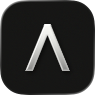

<p align="center">
  <a href="https://code.ankiel.com">
    
  </a>
</p>

<h1 align="center">Ankiel Code</h1>

<p align="center">A minimal, self-hosted GUI for coding agents.</p>

<p align="center">
  <a href="https://code.ankiel.com/download"><strong>Download</strong></a> ·
  <a href="https://app.code.ankiel.com">Web</a> ·
  <a href="./docs/README.md">Docs</a> ·
  <a href="https://github.com/benank/ankielcode/issues">Issues</a>
</p>

Ankiel Code runs the coding agents on your machine and gives them one fast interface. Start a thread at your desk, then approve the next step from your phone. You run the server, so your threads, code, and credentials stay on hardware you control.

It works with Claude Code, Codex, Cursor, OpenCode, Grok Build, Antigravity, Kiro, Pi, Muse Code, fx, and any [ACP](./docs/user/providers-acp.md) agent. If an agent is set up on your computer, Ankiel Code can control it.

Ankiel Code is forked from [T3 Code](https://github.com/pingdotgg/t3code) (MIT).

## What you get

- **Your subscriptions.** Ankiel Code does not resell tokens. It drives the agents you are already signed in to.
- **Your data.** There is no account, no telemetry, and no hosted backend to trust.
- **Every agent in one place.** Change models in the middle of a thread. Let Claude hand a task to Codex.
- **Desktop, web, and phone.** One server, and every client shows the same threads.
- **Remote ready.** Run agents on any machine. Connect over your local network, Tailscale, or SSH. See [remote access](./docs/user/remote-access.md).
- **Git built in.** Each thread can work in its own worktree. Review the diff, then commit, push, and open a pull request with one button.
- **Fast.** Performance is a feature here, and a dropped frame is a bug.
- **Open.** The source is MIT licensed. If you don't like something, change it.

## Install

### Desktop app

[Download Ankiel Code](https://code.ankiel.com/download) for macOS, Windows, or Linux, or take a build from [Releases](https://github.com/benank/ankielcode/releases).

### Command line

This installs the `ac` command. Run `ac` to start the server and open the web app.

```bash
curl -fsSL https://code.ankiel.com/install.sh | sh
```

On Windows, in PowerShell:

```powershell
irm https://code.ankiel.com/install.ps1 | iex
```

To try it once without an install, run `npx @ankielcode/cli@latest`.

### Phone

The mobile app is a React Native client for any Ankiel Code server. It is not in the app stores yet. See [apps/mobile](./apps/mobile/README.md) to build it, then follow [remote access](./docs/user/remote-access.md) to connect it to your computer.

### Sign in to an agent

Ankiel Code needs one agent that is installed and signed in. For example, install [Claude Code](https://claude.com/product/claude-code) and run `claude auth login`, or install [Codex CLI](https://developers.openai.com/codex/cli) and run `codex login`.

[Provider setup](./docs/user/install.md#providers) has the steps for each agent. [Install Ankiel Code](./docs/user/install.md) covers nightly builds, AppImage, and WSL.

## Documentation

- [Install and first run](./docs/user/install.md)
- [Remote access from a phone or another machine](./docs/user/remote-access.md)
- [Permission modes](./docs/user/permission-modes.md)
- [Source control](./docs/user/source-control.md)
- [Connect outside agents over MCP](./docs/user/outside-agents.md)
- [FAQ](./docs/user/faq.md)

[All docs](./docs/README.md) has the full list.

## Contributing

Small, focused fixes are the most likely to be merged. Larger features should start as an [issue](https://github.com/benank/ankielcode/issues).

- Read [CONTRIBUTING.md](./CONTRIBUTING.md) before you report a bug or open a pull request.
- Build from source with the [development runbook](./docs/operations/00_development.md#first-checkout). The [architecture overview](./docs/internals/01_architecture.md) explains how it works.

## License

The source code in this repository is licensed under the [MIT License](./LICENSE). [TRADEMARK.md](./TRADEMARK.md) has a short note on names and forks.
